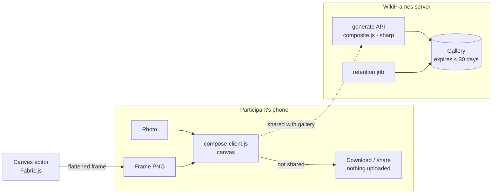

# WikiFrames

**Privacy-first campaign frames for the Wikimedia movement — and every open community.**

[](https://github.com/Zaidusyy/WikiFrames/actions/workflows/ci.yml)
[](LICENSE)

An organizer designs a photo frame, shares one link or QR code, and every
attendee walks away with a personalised, on-brand image they actually want to
post — in under a minute, with no account and no app. When a participant does
not choose to share their image with the gallery, **their photo never leaves
their phone**: the image is made on the device itself.

> Every event is a story. Every attendee is a storyteller.

Built for Wikipedia Day, Wiki Loves Monuments, edit-a-thons, WikiConferences
and campus clubs — and just as useful for any meetup, conference or community
that cares about its members' privacy.

---

## Highlights

### For participants
- Open a link or scan a QR. No login, no account, no personal details.
- Pick a frame and a role badge (“I'm a Heritage Documenter”), add a photo or
  take one, drag and pinch it into place — the preview is the real result.
- **Private by design.** Unless you tick “share with the gallery”, the image
  is composed in your browser and your photo is never uploaded.
- Share image and caption together to WhatsApp, Instagram, Mastodon, Bluesky
  and more, with ready-made alt text for screen-reader users.

### For organizers
- Sign in with your Wikimedia account — identity only, never edit rights.
- A real design editor (Fabric.js), or upload a frame made in Canva, Figma or
  Inkscape — WikiFrames finds the photo hole by itself.
- Roles, captions and hashtags, a print-quality QR code, a venue access code,
  pause/resume/clone, a consented gallery with ZIP export, and analytics that
  count events, never people.

### The editor
| | |
|---|---|
| **Wikimedia Commons library** | Search millions of free images without leaving the editor. Each image keeps its author and licence; credits are shown to participants and the Health Check adds a TASL credit line where the licence requires one. |
| **Magic resize** | Design once, get the story (9:16), feed (4:5), square and landscape versions — re-laid out by intent (anchors, a two-column reflow for landscape, text kept off the photo), not stretched. |
| **Smart guides & snapping** | Snap to other layers, the frame's edges and centre, and the safe margin; align and distribute; groups; rotation snapping; copy/paste; full keyboard shortcuts. |
| **Frame Health Check** | Flags text below WCAG 2.1 AA contrast, text too small for a phone, content under the Instagram/WhatsApp story UI or near the edges, a badge over the photo, blurry images and missing licence credits — with one-click fixes. |
| **Safe-zone overlays** | Story UI, profile-grid crop, square thumbnail and safe margins drawn over the canvas while you design. |
| **True preview** | Drawn by the same compositor participants' phones use, with a sample or your own photo (which stays local). |

---

## Privacy promise

> If you allow it, your generated image is stored so the event organizers can
> showcase it in the campaign gallery. **All stored images are kept for a
> maximum of 30 days after the event closes, then permanently deleted.** If
> you don't allow storage, your image is created on your own device — your
> photo is not uploaded, and nothing is saved on our side.

How that is enforced — on-device rendering, access-checked and signed image
links, EXIF stripping, a retention job that runs inside the server even
without cron — is described in [SECURITY.md](SECURITY.md) and on the
instance's `/privacy` page.

---

## Quick start (development)

Requirements: **Node.js 20.9 – 24** (an LTS release). Nothing else — the database comes with it.

```bash
npm install
cp .env.example .env            # the defaults work for local development

npm run dev:db                  # PostgreSQL (PGlite) on 5433 — leave it running
npm run db:push && npm run db:seed
npm run dev                     # http://localhost:3000
```

Sign in without registering an OAuth consumer:
`http://localhost:3000/api/v1/auth/dev?username=DevOrganizer`
(only when `ALLOW_DEV_LOGIN=true`, and never in production). Then create a
campaign from an event template, design a frame, launch, and open the
participant link from **Links & QR** on your phone.

PGlite serves one query at a time; run `db:push`/`db:seed` before `npm run dev`
and restart `dev:db` if a command reports *“Can't reach database server”*. For
real concurrency use Docker: `docker compose up -d` and the `DATABASE_URL` in
`.env.example`.

```bash
npm run lint      # ESLint
npm test          # unit tests (node:test)
npm run build
```

---

## Deploying

### Docker (recommended)

```bash
cp .env.example .env          # set the values in the table below
docker compose --profile app up -d
```

The image runs as an unprivileged user, applies the database schema on start,
stores files in the `/data` volume, includes Noto fonts (so badges render in
any script and with emoji) and exposes a `/api/v1/health` check. Put a
TLS-terminating reverse proxy (Caddy, nginx, Traefik) in front of port 3000.

### Anywhere Node runs

```bash
npm ci && npm run build && npm start
```

Run behind a reverse proxy, set `TRUST_PROXY_HOPS`, and use a managed
PostgreSQL — or MariaDB/MySQL: give a `mysql://` `DATABASE_URL` (or set
`DATABASE_PROVIDER=mysql` for the build) and `scripts/prisma.mjs` builds the
database client for it.

### Toolforge

WikiFrames runs on [Toolforge](https://wikitech.wikimedia.org/wiki/Help:Toolforge)
with the Build Service and ToolsDB (MariaDB); `Procfile`, `project.toml` and
`scripts/toolforge.mjs` do the Toolforge-specific work. Once you are a
Toolforge member and have created a tool (here `wikiframes`):

1. Register an [OAuth 2.0 consumer](https://meta.wikimedia.org/wiki/Special:OAuthConsumerRegistration/propose/oauth2)
   — identity only ("User identity verification only"), callback
   `https://wikiframes.toolforge.org/api/v1/auth/wikimedia/callback`.
2. On `login.toolforge.org`, `become wikiframes`, then create the database
   once (the name must start with your tool's ToolsDB user, shown by
   `grep user ~/replica.my.cnf`):

   ```sql
   sql tools
   CREATE DATABASE s12345__wikiframes CHARACTER SET utf8mb4 COLLATE utf8mb4_bin;
   ```
3. Store the settings (each command prompts for the value):

   ```bash
   toolforge envvars create APP_BASE_URL       # https://wikiframes.toolforge.org
   toolforge envvars create APP_SECRET         # openssl rand -hex 32
   toolforge envvars create WIKIMEDIA_CLIENT_ID
   toolforge envvars create WIKIMEDIA_CLIENT_SECRET
   toolforge envvars create WIKIMEDIA_CONTACT  # e.g. https://wikiframes.toolforge.org or your user page
   ```
4. Build and start:

   ```bash
   toolforge build start https://gitlab.wikimedia.org/toolforge-repos/wikiframes
   toolforge webservice buildservice start --mount=all
   ```

   After each new build: `toolforge webservice restart`. Logs:
   `toolforge webservice buildservice logs -f`.

On every start the launcher points the app at ToolsDB, keeps frames and
gallery images in the tool's data directory (readable by the tool only),
creates the tables with case-sensitive collation on first run, applies the
schema and loads the starter templates. Toolforge's proxy hides visitors' IP
addresses from tools by design, so it also sets `CLIENT_IP_HIDDEN=true`:
per-visitor rate limits become event-sized shared ones, and wrong venue codes
are counted per campaign. The retention job runs inside the web service; no
cron job is needed.

### Configuration

| Variable | Required in production | Purpose |
|---|---|---|
| `APP_BASE_URL` | yes (https) | Public URL of the instance |
| `APP_SECRET` | yes (32+ chars) | Signs participants' short-lived image links |
| `DATABASE_URL` | yes | PostgreSQL or MariaDB/MySQL connection |
| `WIKIMEDIA_CLIENT_ID` / `_SECRET` | yes | [OAuth 2.0 consumer](https://meta.wikimedia.org/wiki/Special:OAuthConsumerRegistration/propose/oauth2), identity scope, callback `<APP_BASE_URL>/api/v1/auth/wikimedia/callback` |
| `WIKIMEDIA_CONTACT` | recommended | Contact for Wikimedia's User-Agent policy |
| `SUPER_ADMIN_USERNAMES` | — | Platform admins, checked at every sign-in |
| `RETENTION_DAYS` | — | 1–30, default 30 |
| `RETENTION_SCHEDULER`, `RETENTION_INTERVAL_MINUTES` | — | In-process purge (default on, hourly) |
| `CRON_SECRET` | if using cron | Bearer token for `POST /api/v1/cron/retention` / `npm run purge` |
| `TRUST_PROXY_HOPS` | — | Reverse proxies in front of the app (default 1) |
| `CLIENT_IP_HIDDEN` | — | `true` where the host hides visitor IPs (Toolforge; set by the launcher) |
| `STORAGE_DRIVER` | — | `local` (default) or `s3` (+ `S3_*`, `npm i @aws-sdk/client-s3`) |
| `RATE_LIMIT_GENERATE_PER_HOUR` | — | Server renders per IP per campaign (default 60) |

Production refuses to start when a required value is missing.

---

## How it works



Both compositors share `src/lib/geometry.js`, so an image made on a phone is
the same image the server would make.

| Layer | Choice |
|---|---|
| Framework | Next.js 15 (App Router), React 19, JavaScript |
| Design system | Codex-aligned tokens and Codex icons (Wikimedia Design System) |
| Editor | Fabric.js 7 |
| Images | sharp (server), Canvas 2D (device) |
| Database | PostgreSQL via Prisma |
| Storage | Local filesystem or any S3-compatible bucket |
| Auth | Wikimedia OAuth 2.0 with PKCE |

---

## Accessibility

Codex-aligned colours, visible focus everywhere, keyboard-operable editor and
participant flow (including buttons to move a photo without dragging),
reduced-motion support, alt text on every image — and the Health Check makes
the frames themselves meet WCAG 2.1 AA contrast.

## Contributing

The code lives on [GitHub](https://github.com/Zaidusyy/WikiFrames); an exact
copy on [Wikimedia GitLab](https://gitlab.wikimedia.org/zaidusyy/wikiframes)
is updated by CI after every green build of `main` and every release tag,
and is what Toolforge builds from. Please open issues and pull requests on
GitHub — changes made directly on GitLab would stop the copy.

Issues and pull requests are welcome — see [CONTRIBUTING.md](CONTRIBUTING.md)
and the [Code of Conduct](CODE_OF_CONDUCT.md). Please report security problems
privately as described in [SECURITY.md](SECURITY.md).

## Licence

WikiFrames is free software under the **[MIT License](LICENSE)** (SPDX: `MIT`),
© 2026 Zaid Sayyed and Sanskar Dubey. Third-party components and
their licences are listed in [THIRD_PARTY_NOTICES.md](THIRD_PARTY_NOTICES.md);
the interface icons come from Codex (MIT). Shipped artwork is original and
released under the same licence.

WikiFrames is an independent project and is **not endorsed by or affiliated
with the Wikimedia Foundation**. Wikimedia trademarks (the puzzle globe,
wordmarks, project logos) are not used; the default templates are
wiki-*inspired* originals.
